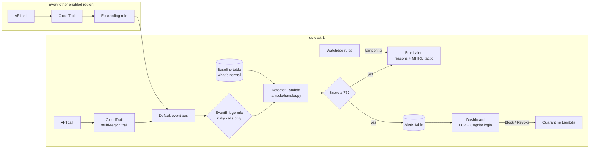

# AWS IAM Insider Threat Detection

**InsiderWatch** watches every AWS API call in an account and alerts when an
identity does something **unusual for that specific identity**, not just
something on a known-bad list. Built with Terraform and Python for our Cloud
Computing group project.

A stolen access key and a malicious insider look the same in the logs: a valid
identity making valid calls. What gives them away is behaving differently from
that identity's own history. So InsiderWatch learns each user's normal
behaviour, scores every risky call against it, and sends an explained alert
when the score crosses a threshold.

**Highlights**

- Behavioural scoring per identity: new API, region, hour and IP address
- High-risk APIs mapped to MITRE ATT&CK tactics, shown in every alert
- Covers every enabled region, with one detector in us-east-1
- Email alerts plus a web dashboard with login, alert history and a what-if score calculator
- One-click **Block** and **Revoke** of a suspicious IAM user from the dashboard
- Self-protection: tampering with the detector, its rules or its tables alerts on its own
- Runs at about **$0** on the AWS free tier

---

## Contents

- [Try it in your own AWS account](#try-it-in-your-own-aws-account)
- [How it works](#how-it-works)
- [Scoring](#scoring)
- [The dashboard](#the-dashboard)
- [Self-protection and data recovery](#self-protection-and-data-recovery)
- [Team setup (shared account)](#team-setup-shared-account)
- [Testing](#testing)
- [Cost](#cost)
- [Repository layout](#repository-layout)
- [Known limitations](#known-limitations)
- [Team and workflow](#team-and-workflow)

---

## Try it in your own AWS account

The fastest way to see it working. This deploys the whole project into **your
own** AWS account from
[AWS CloudShell](https://console.aws.amazon.com/cloudshell/home?region=us-east-1),
which already has the AWS CLI, Python and git and is already signed in. Nothing
needs installing on your laptop.

**You need:** a login that can create IAM roles and users (an admin user, or
root on a personal test account). Restricted lab accounts may not work.

### 1. Deploy (about 8 to 10 minutes)

In the AWS console, switch to **us-east-1 (N. Virginia)**, open CloudShell, and run:

```bash
git clone https://github.com/RyanSeidel/AWS_IAM_Detection.git
cd AWS_IAM_Detection
bash demo/quickstart.sh you@example.com
```

The script:

- installs Terraform and boto3 if missing
- keeps Terraform state in this folder, never in our team's S3 bucket
- deploys the detector, the dashboard and `dana-test`, a real IAM user who plays the insider
- gives dana a real access key (AWS profile `dana-test`) and waits for the dashboard
- prints the dashboard link, the login and the attack commands

Click the link in the "AWS Notification - Subscription Confirmation" email if
you also want alert emails.

### 2. Log in to the dashboard

Open the printed link. Username `admin@insider.com`, with the temporary password
the script prints. You'll be asked to set your own.

> Signed in as root? You'll already see some root alerts from the setup. Root
> activity always alerts, by design.

### 3. Attack

These are **real AWS calls** made with dana's real key, so they go through the
real pipeline. Dana has no history yet, so she scores as an unknown identity
(+40) plus each risky call:

```bash
# Steal a secret (Credential Access): 80
aws ssm get-parameter --name /demo/db-password --with-decryption --region eu-west-1 --profile dana-test

# Create a backdoor key (Persistence): 80
aws iam create-access-key --user-name dana-test --profile dana-test

# Try something she isn't allowed to: AccessDenied is expected, and it still alerts at 105
aws iam create-user --user-name backdoor-admin --profile dana-test
```

Within about 1 to 5 minutes, pick `dana-test` in the dashboard's identity
dropdown and open **My alerts**. From there you can **Block** her with one click.

### 4. Clean up

```bash
bash demo/cleanup.sh you@example.com
```

This removes everything, so nothing keeps running or costing money.

---

## How it works



1. **CloudTrail** records every management API call in every region into one S3 bucket.
2. **EventBridge** passes on only the calls worth scoring:
   - mutating calls, a short list of sensitive reads (secrets, decoy object reads),
     denied calls (`AccessDenied`, `UnauthorizedOperation`) and console sign-ins;
   - made by a person or role, not by an AWS service acting on its own.
3. **The detector Lambda** looks up the identity's baseline, adds up a risk
   score, and decides whether to alert. If the baseline lookup fails, it
   alerts anyway (it *fails closed*).
4. **Alerts** go out by email through SNS, explaining in plain language why
   they fired, and are saved to the alerts table for the dashboard.

**Multi-region.** An EventBridge rule can't invoke a Lambda in another region,
but it can forward events to another region's event bus. So every enabled
region gets a small forwarding rule that sends matching events to us-east-1.
There is one detector, one scoring path and one alert topic. Regions are
discovered automatically ([main/forwarding.tf](main/forwarding.tf)).

### The baseline: what's normal for each identity

[helpers/seed_baseline.py](helpers/seed_baseline.py) reads up to 90 days of
CloudTrail history and stores a profile per identity: the APIs, regions, UTC
hours and IP addresses it normally uses. It runs automatically after
`terraform apply`, and can be re-run any time to learn new normal activity.

**Example.** Two events, both using `admin.me`'s valid key:

| | admin.me, normally | Someone with a stolen key |
|---|---|---|
| Action | `s3:CreateBucket` | `ssm:GetParameter` (reading a secret): high-risk +40 |
| API | used before ✓ | never used ✗ +20 |
| Region | us-east-1 ✓ | eu-west-1 ✗ new region +75 |
| Time | 3 pm ✓ | 4 am ✗ unusual hour +25 |
| IP | home ✓ | unknown ✗ new IP +25 |
| **Score** | **0: nothing happens** | **185: alert** |

A list of "bad API calls" can't tell these apart, because both come from a
real, valid identity. The baseline can.

---

## Scoring

Every event that reaches the detector gets a score. **75 or more sends an alert.**

| The event is… | Points |
|---|---|
| In a region this identity has never used | +75 (alerts on its own) |
| A high-risk API (see below) | +40 |
| From an identity with no baseline | +40 |
| Console sign-in without MFA | +40 |
| Security group opened to `0.0.0.0/0` or `::/0` | +35 (on top of the high-risk API) |
| At a UTC hour this identity is never active | +25 |
| From an IP address this identity has never used | +25 |
| Denied (`AccessDenied`, `UnauthorizedOperation`) | +25 |
| Failed console sign-in | +25 |
| An API this identity has never called | +20 |
| Tampering with logging or with the detector itself | +75 (alerts on its own) |
| Any activity by the root user | raised to at least 75 (always alerts) |

**High-risk APIs, by MITRE ATT&CK tactic**

| Tactic | APIs |
|---|---|
| Privilege Escalation | `iam:AttachUserPolicy`, `PutUserPolicy`, `AttachRolePolicy`, `PutRolePolicy`, `CreatePolicyVersion`, `SetDefaultPolicyVersion`, `AddUserToGroup`, `UpdateAssumeRolePolicy` |
| Persistence | `iam:CreateAccessKey`, `CreateLoginProfile`, `UpdateLoginProfile`, `CreateUser`, `lambda:CreateFunction` |
| Credential Access | `ssm:GetParameter`, `ssm:GetParameters`, `secretsmanager:GetSecretValue` |
| Defense Evasion | `iam:DeactivateMFADevice`, `ec2:AuthorizeSecurityGroupIngress` |
| Defense Evasion, +75 | `cloudtrail:StopLogging`, `DeleteTrail`, `UpdateTrail`, `PutEventSelectors`, `guardduty:DeleteDetector`, `config:StopConfigurationRecorder`, `kms:ScheduleKeyDeletion`, and changes to the detector's own rules, Lambda, alert topic or tables |
| Exfiltration | `s3:PutBucketPolicy`, `PutBucketAcl`, `PutBucketReplication`, `DeleteBucketPublicAccessBlock`, `ec2:ModifySnapshotAttribute`, `ModifyImageAttribute`, `rds:ModifyDBSnapshotAttribute` |
| Collection | `s3:GetObject` (only for buckets with CloudTrail data events turned on, such as a decoy bucket) |
| Resource Hijacking | `ec2:RunInstances` |

The full list lives in `HIGH_RISK_APIS` in [lambda/handler.py](lambda/handler.py).

---

## The dashboard

A Streamlit app (Docker image `shadab998/insiderwatch:latest`) on a small EC2
server, behind an Amazon Cognito login. Get its address with
`terraform output dashboard_url`.

| Page | What it shows |
|---|---|
| **My alerts** | Every alert: score, identity, API, region, MITRE tactic and the reasons. **Block** and **Revoke** buttons, each with a confirmation step |
| **What's normal for me** | The selected identity's baseline: usual APIs, regions, hours and IPs |
| **What triggers an alert** | A what-if calculator that scores an imaginary call against the live baseline, plus the point values |

Pick **All Profiles** or one identity in the sidebar to filter every page.

**Block and Revoke.** The dashboard calls a separate quarantine Lambda
([lambda/quarantine.py](lambda/quarantine.py)):

- **Block** attaches a deny-all policy to the IAM user and deactivates their access keys.
- **Revoke** removes that policy and reactivates the keys.
- Both send an email. The root user and the detector itself can never be blocked.

**Login.** Username `admin@insider.com`. On a new deployment, the first login
uses the temporary password in [main/cognito.tf](main/cognito.tf) and asks you
to set your own. Only an admin can create users (no self sign-up). To reset a
forgotten password:

```bash
aws cognito-idp admin-set-user-password --user-pool-id <pool-id> \
  --username admin@insider.com --password '<new password>' --permanent
```

**High availability (optional).** `-var="enable_alb_asg=true"` puts the
dashboard behind a load balancer with an Auto Scaling group, which replaces the
server automatically if it fails. In this mode, port 8501 only accepts traffic
from the load balancer. Off by default because it costs extra (about $16 to $22
a month).

---

## Self-protection and data recovery

An attacker's first move is often to switch off the alarm, so the detector
watches itself.

- **Tampering alerts.** Disabling or deleting the detector's EventBridge rules,
  changing or deleting its Lambda, unsubscribing the alert email, or deleting
  or changing its DynamoDB tables or their backups all score +75.
- **Watchdog rules.** `insider-threat-watchdog` and
  `insider-threat-watchdog-tables` email the alert topic **directly**, so these
  alerts arrive even if the detector Lambda itself was broken.
- **No SSH.** Port 22 is closed on the dashboard server, which is rebuilt from
  its startup script instead.

**Data protection (optional).** Off by default, so nobody reusing this project
pays for it without knowing:

```bash
terraform apply -var="alert_email=you@example.com" -var="protect_data=true"
```

This turns on **deletion protection** and **point-in-time recovery** for both
tables (`insider-threat-baseline` and `insider-threat-alerts`). To tear down
with it on, apply with `-var="protect_data=false"` first, then destroy.

**Restoring after an attack** (needs `protect_data=true` beforehand):

- *Table deleted:* AWS keeps a backup named `<table>$DeletedTableBackup` for 35
  days. Restore it under the original name, then run `terraform apply`:

  ```bash
  aws dynamodb list-backups --table-name insider-threat-alerts --backup-type SYSTEM
  aws dynamodb restore-table-from-backup \
      --target-table-name insider-threat-alerts --backup-arn <BackupArn from above>
  ```

- *Rows deleted or edited:* restore a copy from just before the attack (this
  always creates a new table), check it, then copy the rows back:

  ```bash
  aws dynamodb restore-table-to-point-in-time \
      --source-table-name insider-threat-alerts \
      --target-table-name insider-threat-alerts-restored \
      --restore-date-time 2026-11-07T20:00:00Z
  ```

- *Baselines only:* these can also be rebuilt from CloudTrail by re-running
  `seed_baseline.py`. Alerts can't, which is why backups matter most for them.

---

## Team setup (shared account)

For the four of us working in the team account, where Terraform state is
shared in S3. Everyone else should use [Try it in your own AWS account](#try-it-in-your-own-aws-account).

Each teammate needs their **own IAM user and access key**. Sharing credentials
mixes everyone's behaviour into one baseline, which defeats the project.

**1. Install the tools**

```bash
# macOS
brew install terraform awscli
python3 -m pip install boto3
```

```powershell
# Windows PowerShell (not as Administrator), then reopen PowerShell
winget install HashiCorp.Terraform
winget install Amazon.AWSCLI
pip install boto3
```

**2. Configure credentials**

```bash
aws configure                 # key id, secret, us-east-1, json
aws sts get-caller-identity   # must end in :user/your-name, never :root
```

**3. Deploy.** The state bucket is created once per account (already done for
the team account):

```bash
cd bootstrap && terraform init && terraform apply
```

Then the detector and dashboard:

```bash
cd main
terraform init
terraform plan  -var="alert_email=you@example.com"
terraform apply -var="alert_email=you@example.com"
```

Always read the plan before applying, and stop if it wants to destroy something
unexpected. Tell the team before you apply or destroy: we all share one stack.
Click the link in the confirmation email, or no alert emails are delivered.

**Options:**

| Variable | Default | What it does |
|---|---|---|
| `alert_email` | (required) | Where alerts are emailed |
| `demo_user` | `false` | Creates `dana-test` and the decoy secret for live demos |
| `protect_data` | `false` | Deletion protection + point-in-time recovery for both tables |
| `enable_alb_asg` | `false` | Load balancer + Auto Scaling for the dashboard |

**4. Baselines.** `terraform apply` seeds them automatically. To refresh them
later (for example after new normal activity):

```bash
python3 helpers/seed_baseline.py
```

---

## Testing

**Unit tests** (no AWS needed; mocked clients):

```bash
python3 -m pytest tests
```

31 tests cover the scoring rules, denied calls, console sign-ins, root
activity, tampering with the detector and its tables, and the attack simulator.

**Live check.** Trigger an event in another region (this also tests
forwarding), then watch the detector's log:

```bash
aws s3api create-bucket --bucket test-detect-euw1-<account-id> --region eu-west-1 \
    --create-bucket-configuration LocationConstraint=eu-west-1
aws s3api delete-bucket --bucket test-detect-euw1-<account-id> --region eu-west-1
aws logs tail /aws/lambda/insider-threat-detector --since 5m --region us-east-1
```

Each log line shows the identity, API, score, reasons and whether it alerted.

**Attack simulator.** [helpers/simulate_attack.py](helpers/simulate_attack.py)
replays scripted attack scenarios as `dana-test` against a synthetic baseline
(`fake_events.json`) and prints each score. We used it to test the pipeline
end to end; the live demo uses the real commands shown above instead.

---

## Cost

Designed to run at about **$0** on the free tier:

- Management events only (no CloudTrail data events or Insights) and a single trail
- `AES256` encryption instead of KMS keys ($1 a month each)
- DynamoDB at 5 read / 5 write capacity units per table, inside the free tier; 7-day Lambda logs; 30-day CloudTrail log expiry
- Dashboard on one free-tier `t3.micro` server
- No VPC for the Lambdas (that would need a NAT gateway, about $33 a month)

Extra cost only if you turn it on: `enable_alb_asg` (about $16 to $22 a month)
and `protect_data` (point-in-time backups, a few cents for tables this size).

Run `terraform destroy` (or `demo/cleanup.sh`) when you're done. This deletes the
tables, logs and alert history, so baselines are re-seeded on the next deploy.

---

## Repository layout

| Path | What it is |
|---|---|
| [demo/](demo/) | `quickstart.sh` and `cleanup.sh`: one-command deploy and removal in your own account |
| [main/](main/) | All Terraform for the detector and dashboard |
| [main/main.tf](main/main.tf) | Multi-region CloudTrail trail, its S3 log bucket, auto-seeding of baselines |
| [main/eventbridge.tf](main/eventbridge.tf) | Event filter, detector Lambda, quarantine Lambda and their IAM roles |
| [main/forwarding.tf](main/forwarding.tf) | Per-region forwarding rules to us-east-1 |
| [main/watchdog.tf](main/watchdog.tf) | Watchdog rules that email directly on tampering |
| [main/dynamodb.tf](main/dynamodb.tf) | Baseline and alerts tables, optional data protection |
| [main/sns.tf](main/sns.tf) | Alert topic and email subscription |
| [main/ec2.tf](main/ec2.tf), [main/cognito.tf](main/cognito.tf) | Dashboard server, its firewall rules, and login |
| [main/high_availability.tf](main/high_availability.tf) | Optional load balancer and Auto Scaling group |
| [main/dana.tf](main/dana.tf) | Optional `dana-test` demo user and decoy secret |
| [lambda/handler.py](lambda/handler.py) | Scoring and alerting logic |
| [lambda/quarantine.py](lambda/quarantine.py) | Block and Revoke actions used by the dashboard |
| [ec2/](ec2/) | Dashboard app (`dashboard.py`) and its Dockerfile |
| [helpers/](helpers/) | Baseline seeder, synthetic history generator, attack simulator, personas |
| [tests/](tests/) | Unit tests |
| [bootstrap/](bootstrap/) | S3 bucket for the team's shared Terraform state (run once) |
| [Updates/](Updates/), [TASK-3.md](TASK-3.md), [TASK-4.md](TASK-4.md) | Build log, detection guide and design notes |

---

## Known limitations

- **Shared roles share a baseline.** Assumed-role sessions resolve to the role,
  so people sharing a role share one profile.
- **Baselines are a snapshot.** They change only when the seed script runs again.
- **The seed script learns from whatever happened.** Any activity in the last
  90 days, including attacks or tests, counts as normal.
- **New identities have no history**, so they score on the fixed rules only
  (+40 unknown, plus any high-risk call) until they're seeded.
- **Item-level table edits aren't detected.** Deleting single rows is a
  CloudTrail data event, which we leave off for cost; backups cover recovery instead.
- **Detection, then response.** The detector notices misuse after the call has
  happened; blocking is a manual click on the dashboard, not automatic.

---

## Team and workflow

Built by Ryan, Shadab, Rency and Yael.

Work happens on task branches, which are merged into `test` through pull
requests and then into `main`:

```bash
git checkout test && git pull
git checkout -b task-your-change
# ...make changes, commit...
git push -u origin task-your-change    # then open a pull request into test
```

Never commit Terraform state, plan files, `.tfvars` or access keys; `.gitignore`
already blocks them.
